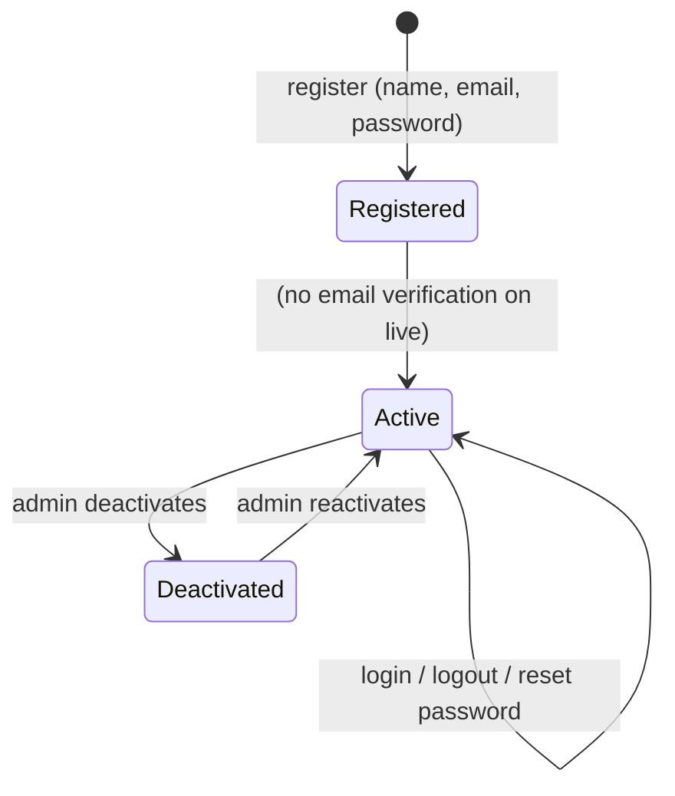

# 03 · User Roles and Permissions

Who can do what on the replica site. The access rules for existing pages are **verified on live** (logged out, 12 Oct 2026). Rules for logged-in and admin areas are derived from the PHP code and the workflows ([04](04-workflows.md)).

Confidence marks: ✅ Live · 📄 Code · 🔎 Inferred · ❓ Unknown.

---

## 1. Roles

| Role | Who | How identified | Current site | Replica |
| --- | --- | --- | --- | --- |
| **Visitor** (guest) | Anyone not logged in | No session | ✅ | Same |
| **User** (customer) | Registered person (name, email, password) | User session cookie | ✅ `users` table, PHP session `user_id` | `users` collection, session cookie `sanyod.sid` |
| **Admin** | Site staff | Separate admin login with **username** + password (+ remember me) | ✅ `/admin/login.php` → `authenticate.php` | `admins` collection, `role: 'admin'` |
| **Super admin** (new) | Owner / technical admin | Admin with `role: 'superadmin'` | — | Can manage admin accounts and site settings |

Derived access states (not roles):

| State | Meaning | Used for |
| --- | --- | --- |
| **Owner** | The user who created a resource (payment, order, consultation, booking) | Viewing own records |
| **Entitled** | User with an **approved** purchase (entitlement) of a PDF book or course | Reading PDFs, playing paid videos |
| **Pending** | User with a submitted but unapproved payment | Shows "pending" state, blocks a duplicate purchase |

There is **no doctor, author or instructor role**. Doctors are content records; they are contacted outside the system. A doctor portal would be a new feature (see [14](14-open-questions-and-decisions.md)).

---

## 2. Page access (frontend routes)

| Route (replica) | Legacy page | Visitor | User | Admin | Verified |
| --- | --- | --- | --- | --- | --- |
| `/`, `/about`, `/contact`, `/peace-building` | index, about, contact, Peace_Building | ✅ | ✅ | ✅ | ✅ public on live |
| `/spirituality/*` (4 pages) | ind_know, lab, counity, presonal | ✅ | ✅ | ✅ | ✅ public |
| `/personality-test` | Personality_Test | ✅ | ✅ | ✅ | ✅ public |
| `/books` | books | ✅ | ✅ | ✅ | ✅ public |
| `/books/:slug` | books_details | → login | ✅ | ✅ | ✅ redirects to login |
| `/courses`, `/courses/:slug` | courses, course_details | ✅ | ✅ | ✅ | ✅ public |
| `/courses/:slug/payment` | payment | → login | ✅ | — | ✅ redirects to login |
| `/payment/success` | payment_success | → login | ✅ (after submit) | — | ✅ direct visit → courses |
| `/programs` | programes | → login | ✅ | ✅ | ✅ redirects to login |
| `/health` | health | ✅ | ✅ | ✅ | ✅ public |
| `/health/doctors/:slug` | doctor_detail | → login | ✅ | ✅ | ✅ redirects to login |
| `/my-books`, `/my-books/:slug/read` | my_books, read_pdf, view_pdf, view_book | → login | ✅ (reading: Entitled) | — | ✅ redirects to login |
| `/my-courses` | my_courses | → login | ✅ | — | ✅ live is broken (warning); should redirect |
| `/my-orders` | my_orders | → login | ✅ | — | ✅ live returns 500 |
| `/login`, `/register`, `/forgot-password`, `/reset-password` | login, register, forget, reset_password | ✅ | → home (🔎) | — | ✅ public |
| `/admin/login` | admin/login.php | ✅ | ✅ | → `/admin` | ✅ public |
| `/admin/*` | admin/* | → `/admin/login` | → `/admin/login` | ✅ | ✅ redirects (but leaks HTML on live) |

"→ login" means: redirect to `/login`, then return to the requested page after login (same as PHP `redirect_url`).

---

## 3. Permission matrix (actions)

### 3.1 Public site and user actions

| Action | Visitor | User | Admin | Rule |
| --- | --- | --- | --- | --- |
| Browse public pages, catalogues, doctor list | ✅ | ✅ | ✅ | |
| Take the Personality Test | ✅ | ✅ | ✅ | Client-side only |
| View course playlist list | Prompt "Login Required" | ✅ | ✅ | ✅ SweetAlert on live |
| Play a **free** course video | ❌ (login prompt) | ✅ | ✅ | `isFree` |
| Play a **paid** course video | ❌ | Entitled only | ✅ (preview) | API sends `youtubeId` only if allowed |
| View book details / purchase options | ❌ | ✅ | ✅ | |
| Submit a book / course / event payment | ❌ | ✅ | ❌ | Amount from the server; one pending payment per item |
| Read / download a purchased PDF | ❌ | Entitled | ✅ | Streamed through the API |
| View own payments, orders, bookings, consultations | ❌ | Owner | ✅ | |
| Request a consultation | ❌ | ✅ | — | User from the session |
| Send contact message / guidance request / newsletter | ✅ | ✅ | — | Rate-limited |
| Update own profile / password | — | ✅ (🔎 new; live has no profile page) | — | Optional |

### 3.2 Admin actions

| Action | Admin | Super admin |
| --- | --- | --- |
| View dashboard | ✅ | ✅ |
| Approve / reject payments (books, courses, events) | ✅ | ✅ |
| Update order status / tracking | ✅ | ✅ |
| CRUD books (incl. cover + PDF upload) | ✅ | ✅ |
| CRUD courses and videos | ✅ | ✅ |
| CRUD doctors (photo, CV) | ✅ | ✅ |
| Manage consultations | ✅ | ✅ |
| CRUD events, manage bookings | ✅ | ✅ |
| View users, activate/deactivate | ✅ | ✅ |
| Grant / revoke entitlements manually | ✅ | ✅ |
| View contact messages, guidance requests, subscribers | ✅ | ✅ |
| Edit site settings (contact info, UPI IDs, QR, hours, social links) | ❌ | ✅ |
| Manage admin accounts | ❌ | ✅ |

❓ The live admin panel's real permissions are unknown (only its login page is visible). Confirm with the server source ([14](14-open-questions-and-decisions.md)).

---

## 4. Enforcement

| Layer | Mechanism |
| --- | --- |
| Backend (authoritative) | Middleware: `requireUser`, `requireAdmin`, `requireSuperAdmin`, `requireOwner(resource)`, `requireEntitlement(itemType, itemId)`. Every `/api/admin/*` route is behind `requireAdmin`. |
| Frontend (UX only) | Route guards `RequireAuth`, `RequireAdmin`, `GuestOnly`; UI hides actions the user can't perform. The frontend is never trusted for access decisions. |
| Data | Queries are always filtered by `user: req.user.id` for user-owned data. |
| Files | Private files only through authorised streaming endpoints (no static URLs). |
| Audit | Admin writes recorded in `auditLogs` (who, what, when, before/after). |

Details: [05-authentication.md](05-authentication.md), [08-backend-architecture.md](08-backend-architecture.md).

---

## 5. Account lifecycle

| Topic | Live behaviour | Replica |
| --- | --- | --- |
| Email verification | None (📄) | Not required in release 1 (optional later) |
| Deactivation | ❓ | `isActive=false` blocks login and API access |
| Account deletion | ❓ | Admin action; keeps payments/orders for accounting (anonymised user) |
