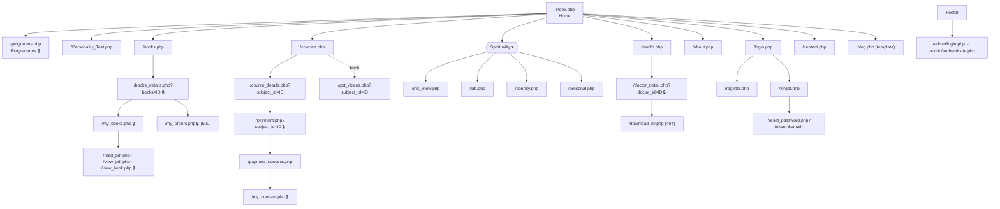
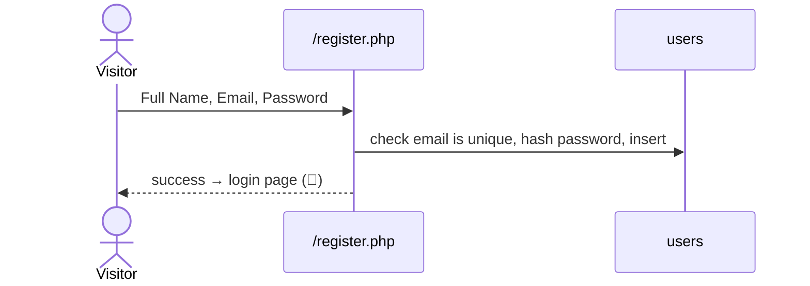
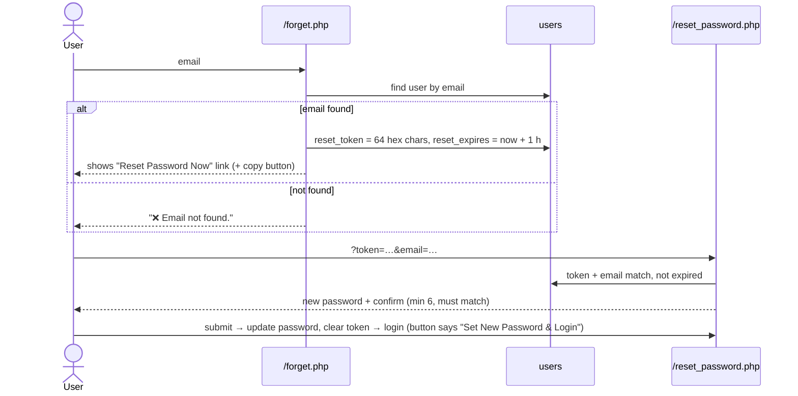
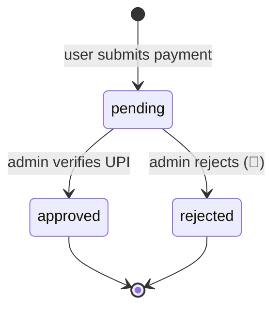
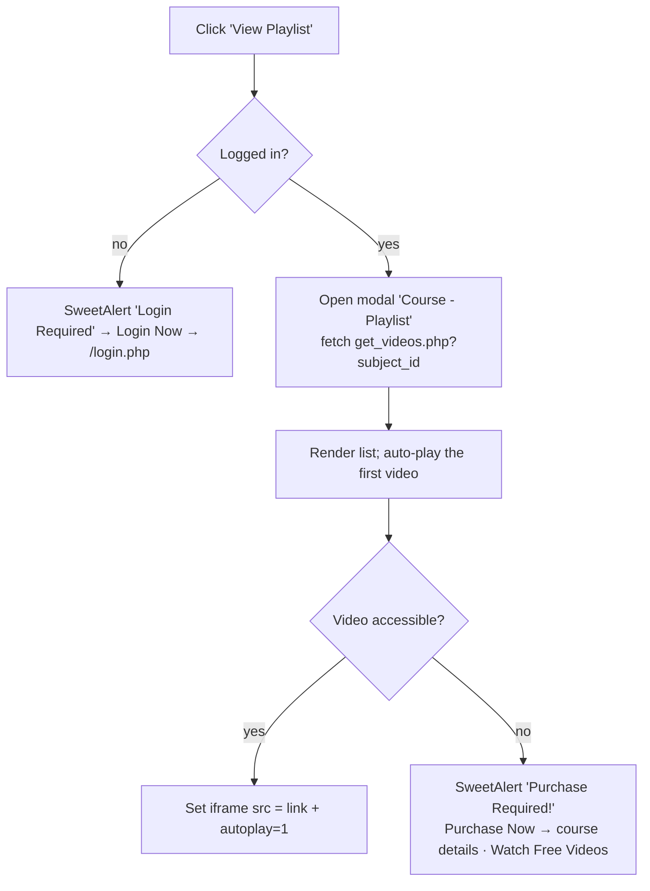

# 04 · Workflows and Overall Functionality

How the site is structured, who can access what, and how each process works from start to finish.

Confidence marks: ✅ Live · 📄 Code · 🔎 Inferred · ❓ Unknown.

---

## 1. Site map



🔒 = redirects to `login.php` when logged out (verified on live; see § 2).

---

## 2. Access control (verified on live)

Checked on 12 Oct 2026 as a **logged-out visitor**:

| URL | Live response | Rule for the rebuild |
| --- | --- | --- |
| `/index.php`, `/books.php`, `/courses.php`, `/course_details.php?subject_id=7`, `/health.php`, `/Personality_Test.php`, `/ind_know.php`, `/lab.php`, `/counity.php`, `/presonal.php`, `/about.php`, `/contact.php`, `/Peace_Building.php`, `/blog.php`, `/service.php`, `/team.php`, `/testimonial.php` | 200 | Public |
| `/login.php`, `/register.php`, `/forget.php`, `/reset_password.php` | 200 | Public (guests) |
| `/programes.php` | 302 → `login.php` | **Login required** |
| `/books_details.php?books=26` | 302 → `login.php` | **Login required** (return to the page after login) |
| `/doctor_detail.php?doctor_id=11` | 302 → `login.php` | **Login required** |
| `/my_books.php`, `/payment.php?subject_id=7`, `/view_book.php`, `/read_pdf.php`, `/view_pdf.php` | 302 → `login.php` | **Login required** |
| `/payment_success.php` (opened directly) | 302 → `courses.php` | Only reachable after a payment submission |
| `/my_courses.php` | 200 + PHP warning "Cannot modify header information" | Should be **login required** (live redirect is broken) |
| `/my_orders.php` | **500** | Login required (fix the crash) |
| `/get_videos.php?subject_id=7` | 200, returns **all video links, including paid ones** | Public list, but **paid video URLs must only go to entitled users** |
| `/admin/login.php` | 200 | Admin guest page |
| `/admin/` | 302 → `login.php` (but sends the dashboard HTML) | **Admin only** (fix the leak) |
| `/Courses.php`, `/Spirituality.php`, `/download_cv.php`, `/payment_status.php` | **404** | Fix the links or create the pages |
| `/contact.php` (first visit) | 409 + script setting cookie `humans_21909=1`, then reload | Hosting bot protection, not part of the app |
| `/admin/authenticate.php` (GET) | 200 "Method Not allowed" | Admin login accepts POST only |
| `/get_videos.php` (no `subject_id`) | 200 + PHP warning (server path) + "No videos available for this course yet." | Validate input; same empty-state text |
| `/Books_pdf/`, `/uploads/`, `/uploads/payments/` (folder URLs) | 403 (directory listing off), **but individual files are downloadable by name** | Private storage |
| `https://sanyod.in/`, `http://www.sanyod.in/` | 200, same page (no redirect to a canonical host/scheme) | 301 to `https://sanyod.in` |
| `/robots.txt`, `/sitemap.xml`, `/favicon.ico` | 404 | Provide them |

Session handling (📄): PHP session (`PHPSESSID`). After login the session holds `user_id` (or `id`), `name` (or `user_name`) and `email`. Protected pages save `redirect_url` before redirecting to login.

---

## 3. Account workflows

### 3.1 Registration



- Fields (✅): `name` (text, required), `email` (email, required), `password` (required).
- ❓ Server rules (uniqueness message, hashing algorithm, auto-login) are not in the local copy. **Rebuild:** unique email, bcrypt hash, minimum 6-character password (matches the reset rule), then go to login or log in automatically.

### 3.2 Login / logout

- Fields (✅): `email`, `password`; link to Register; link "forget".
- 🔎 On success: set the session, redirect to `redirect_url` if set, otherwise home. The error appears in a red alert above the form (📄 `$error`).
- Logout (📄): destroy the session → `login.php`.

### 3.3 Forgot and reset password



- Live without parameters: "❌ Invalid reset link parameters." ✅
- **Rebuild change (security):** **email** the link instead of showing it, show the same message whether or not the email exists, and store only a hash of the token.

---

## 4. Books: purchase and delivery

### 4.1 Business rules (📄 `books_details.php`)

| Rule | Value |
| --- | --- |
| PDF price | `books.price` |
| Hard-copy price | `books.price + 200` |
| Payment method | UPI: scan QR (`Books/QR.jpg`) or pay UPI ID `6355034424@upi` (PDF) / `hardbook.6355034424@upi` (hard copy) |
| Proof | UPI transaction ID (required) + screenshot (jpg, jpeg, png or gif) |
| Order number | `ORD` + `YYYYMMDDHHMMSS` + random 100–999 |
| New payment status | `pending` |
| Purchased when | the latest payment for (user, book, type) has `payment_status = 'approved'` |
| Promised timelines | admin review within 24 h · PDF available within 24 h after approval · shipping 3–5 business days · free shipping in India · 7-day return policy (display text) |

### 4.2 Purchase flow

```mermaid
sequenceDiagram
    actor U as User (logged in)
    participant BD as Book details
    participant API as Server
    participant DB as DB
    participant M as Email
    actor A as Admin
    U->>BD: open /books_details.php?books=ID
    BD->>DB: book + latest PDF payment + latest hard-copy payment (with order)
    U->>BD: choose PDF or Hard Book
    opt Hard Book
        U->>BD: fill shipping address (JSON)
    end
    U->>BD: pay via UPI, enter transaction ID, upload screenshot
    BD->>API: POST submit_payment (multipart)
    API->>DB: BEGIN; insert payments(pending)
    alt hard copy
        API->>DB: insert orders(order_number, pending, shipping_address); payments.order_id = order.id
    else PDF
        API->>DB: payments.order_id = order_number
    end
    API->>DB: COMMIT
    API->>M: customer confirmation (HTML) + admin notification (text)
    API-->>U: redirect to the same page, show success panel (session message)
    A->>DB: review screenshot → approve/reject (🔎)
    Note over U,DB: PDF approved → appears in My Books (read/download)<br/>Hard copy approved → order shipped (order_status)
```

### 4.3 Status lifecycles



| Entity | Known values | Unknown |
| --- | --- | --- |
| `payments.payment_status` | `pending`, `approved` (📄) | `rejected`/other ❓ |
| `orders.order_status` | `pending` (📄) | later states ❓ (suggested: `processing`, `shipped`, `delivered`, `cancelled`) |
| Book details view state | `not_purchased`, `pending`, `approved` per type | |

### 4.4 Emails sent (📄)

| To | Subject | Content |
| --- | --- | --- |
| Customer | `Order Confirmation - <book title>` | HTML. PDF version: order details, "PDF available within 24 hours after approval", how to access. Hard-copy version: order details, processing notice, shipping timeline, what happens next. |
| Admin (`admin@bookstore.com`, placeholder) | `New Order Received - <order number>` | Plain text: order, customer, book, type, amount |

Sender in the code is a placeholder (`Book Store <noreply@bookstore.com>`). **Rebuild:** use real SANYOD addresses through an SMTP/email provider.

### 4.5 Reading purchased books

- **My Books** (📄): welcome bar (name + email), buttons My Orders / Browse Books, stats (Total Books Purchased, PDF Books, current month "Mon YYYY"), grid of purchased PDF books, empty state "No Books Purchased Yet".
- **Read online** (🔎): PDF opened in an embedded viewer (`#toolbar=0&navpanes=0`) with Back to Books and Download buttons; download asks for confirmation.
- **Rebuild rule:** a PDF may only be served (streamed) to a logged-in user with an **approved** PDF or hard-copy purchase of that book. PDFs must not be in a public folder.

---

## 5. Courses: catalogue, playlist access, purchase

### 5.1 Business rules

| Rule | Source |
| --- | --- |
| Card shows price, "40% OFF", video count | ✅ |
| Original price on details page = `floor(price / 0.6)` (e.g. ₹499 → ₹831, ₹19 → ₹31) | ✅ (derived from live values) |
| Videos are YouTube embeds; each is **free** (`data-free=1`) or **paid** (Premium 🔒) | ✅ |
| User can play a video if `is_free` **or** the user has an **approved** purchase of the course | ✅/🔎 (`data-can-access`) |
| Playback appends `autoplay=1` to the embed URL; the selected item is highlighted `#2c3e50` | ✅ |
| One-time payment, lifetime access (display text) | ✅ |

### 5.2 Playlist flow (✅ `courses.php` / `course_details.php` JavaScript)



### 5.3 Course purchase (🔎; local `payment.php` is a placeholder)

1. Course details → "Purchase" → SweetAlert confirmation ("You're about to purchase this course for ₹X … All N videos") → `/payment.php?subject_id=ID` (login required).
2. Payment page: course summary, "Your Information", payment method selection (UPI), UPI ID `6355034424@upi`, transaction ID, screenshot upload (max 5 MB) → "Submit Payment for Approval – ₹X".
3. Server creates a **pending** course payment → `/payment_success.php`: "Payment Submitted Successfully!", Payment ID, status "Pending Approval", approval "usually within 24 hours", buttons **Check My Courses** and **View Payment Status**.
4. Admin approves → videos unlocked; course listed in **My Courses**.

---

## 6. Health consultations

```mermaid
sequenceDiagram
    actor U as User
    participant H as /health.php
    participant D as /doctor_detail.php
    participant DB as DB
    actor Doc as Doctor/Admin
    U->>H: browse doctors by category
    U->>D: View (login required)
    D->>DB: doctor by id
    U->>D: Consult Doctor → fill form → Submit Consultation Request
    D->>DB: insert consultation (🔎 status pending)
    D-->>U: success message; "Doctor will contact you within 24 hours"
    Doc->>U: contacts the patient (outside the system)
```

| Form field | Rule (📄) |
| --- | --- |
| `patient_name` | required |
| `patient_email` | required, email |
| `patient_phone` | required, exactly 10 digits |
| `patient_age` | required, 1–120 |
| `medical_issue` | required |
| `appointment_date` | required, today or later |
| `preferred_time` | Morning (9 AM–12 PM) / Afternoon (12 PM–4 PM) / Evening (4 PM–8 PM) / Any time |
| `symptoms` | required |
| `additional_notes` | optional |
| consent checkbox | required ("I confirm that all information provided is accurate and I consent to teleconsultation") |
| hidden `doctor_id`, `user_id` | **rebuild:** take `user_id` from the session, not the form |

Doctor categories on live: **Physical Health Specialists**, **Mental Health Specialists**, **Chronic Disease Specialists**. "Download CV" → `download_cv.php?doctor_id=` (404 on live; the rebuild should stream the uploaded CV).

---

## 7. Programmes / event booking (🔎; live requires login)

1. `/programes.php` shows three tabs: **Retreat Programs**, **Seminars & Workshops**, **Online Classes**.
2. Each event card: image, title, date, time, location, price → **Book Now** / **Enroll Now**.
3. Booking modal pre-fills event name, date, time, location and price (read-only), shows the UPI QR, and asks for **UPI transaction ID, full name, email, phone (10 digits)** → "I Have Paid — Submit Booking".
4. **Rebuild:** save an event booking with status `pending`; the admin confirms the payment.

Sample events in the local copy (may differ from live): 3-Day Meditation Retreat (₹2,999), Mindfulness & Wellness Retreat (₹3,499), Stress Management Workshop (₹499), Yoga & Meditation Workshop (₹699), Online Meditation Course (₹999), Mindfulness Masterclass (₹1,499).

---

## 8. Front-end-only features

| Feature | Behaviour | Rebuild |
| --- | --- | --- |
| Personality Test | Quiz data (Hindi + English) embedded in the page. Physical → highest of Vata/Pitta/Kapha + suggestions; Emotions → Sattva/Rajas/Tamas scores + suggestions; Karma Situation → zodiac from the DOB month + text | Port as-is to TSX (data in a typed JSON/TS module). Saving results is optional. |
| Library search | Spinner, then `alert("Searching for: …")` | Keep the look; real search optional (P3) |
| Personal guidance request | Modal "Book Your Free Consultation" (Your Name, Email Address, Select Preferred Mentor: Swami Devanand (Vedanta & Meditation) / Dr. Priya Sharma (Yoga & Ayurveda) / Acharya Rajan (Scripture & Rituals) / Any Available Mentor, "Briefly describe your spiritual goals...") → alert "Thank you! We will contact you within 24 hours to schedule your free consultation." **✅ Verified: no element on the live page opens this modal** (dead code) | Wire the CTA/plan buttons to the modal (owner decision), then **save to DB + notify admin** (P2) |
| Contact form | No handler | **Save to DB + email admin** (P2) |
| Newsletter | Button animation "Subscribed!" | **Save subscriber** (P2) |
| Animations | Typing text, counters, particles, floating diyas/books, scroll reveal, hover effects | Port with React hooks |

---

## 9. Admin workflows (inferred)

Only the admin login page is visible (✅ username + password + remember me → `admin/authenticate.php`; template "SB Admin 2"). The user-side flows imply that the admin must be able to:

| Area | Actions |
| --- | --- |
| Dashboard | Counts (users, pending payments, orders, revenue) 🔎 |
| Book payments | List, view screenshot + transaction ID, **approve / reject** |
| Orders (hard copies) | List, view shipping address, update `order_status` |
| Books | CRUD; upload cover (`Books/`) and PDF (`Books_pdf/`); set price |
| Courses | CRUD (name, description, image, price, discount) |
| Course videos | CRUD (title, YouTube link, free/paid, order) |
| Course payments | Approve/reject → unlock course |
| Doctors | CRUD (name, category, photo, bio, CV) |
| Consultations | List and update status |
| Events and bookings | CRUD events (image, date, time, location, price, category); confirm bookings |
| Users | List / search |
| Messages | (new) contact messages, guidance requests, newsletter subscribers |

❓ **Confirm the real admin feature list** from the server's `admin/` folder before building.

---

## 10. Cross-cutting behaviour

| Topic | Current behaviour | Rebuild requirement |
| --- | --- | --- |
| Flash messages | Stored in the session (`order_success`, `order_error`), shown once after redirect | Show a toast/alert after the API response, with the same markup |
| Validation | HTML5 `required`/`pattern` + small JS checks | The same browser checks **plus** server-side validation (zod) |
| File uploads | Saved to public folders with `time()_<original name>` | Random names, type/size checks, private storage for proofs and PDFs |
| Errors | PHP warnings shown to users | Never show stack traces; use a generic error page |
| Language | Mostly Hindi content with English UI labels; quiz has its own switch | Keep the texts exactly; UTF-8 everywhere |
| SEO | Same `<title>` on almost every page | Keep it, or improve with per-page titles (decision) |
