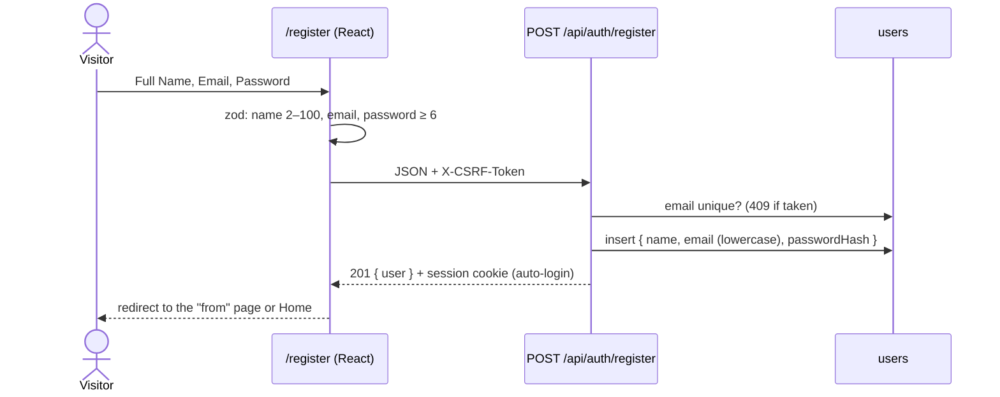
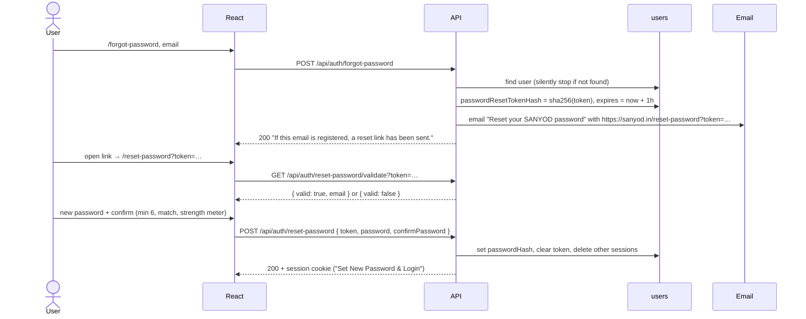

# 05 · Authentication and Session Management

How users and admins sign in, stay signed in, recover passwords, and how access is enforced. Part A describes the current PHP behaviour (the reference). Part B is the replica design.

Confidence marks: ✅ Live · 📄 Code · 🔎 Inferred · ❓ Unknown.

---

## Part A · Current behaviour (reference)

| Topic | Current PHP site |
| --- | --- |
| Mechanism | PHP native session, cookie `PHPSESSID` (✅ set on every page), no expiry (ends when the browser closes) 🔎 |
| Session keys | `user_id` or `id`, `name` or `user_name`, `email` (📄 header.php, books_details.php) |
| Register | `register.php`: Full Name, Email, Password (✅ form); server logic missing locally (❓ hashing, duplicate check, auto-login) |
| Login | `login.php`: Email, Password, `autocomplete="off"` (✅); errors shown in a red alert (📄 `$error`) |
| Return after login | Protected pages store `$_SESSION['redirect_url']` before redirecting to `login.php` (📄) |
| Logout | `logout.php`: `session_destroy()` → `login.php` (📄) |
| Forgot password | `forget.php`: if the email exists → 64-hex token (`random_bytes(32)`), `reset_expires = now + 1 h`, stored **in plain text** in `users`; the reset link is **shown on screen** with a copy button (📄). Unknown email → "❌ Email not found." |
| Reset password | `reset_password.php?token=…&email=…`: new + confirm (min 6, must match), strength meter, button "Set New Password & Login" (✅ UI); without parameters → "❌ Invalid reset link parameters." (✅) |
| Admin login | `/admin/login.php`: **Username**, Password, Remember me → `POST admin/authenticate.php` (✅; GET returns "Method Not allowed") |
| Admin guard | `/admin/` redirects to `login.php` **but still sends the dashboard HTML** (✅ security bug) |
| Protection | No CSRF tokens, no rate limiting, no HTTPS redirect (✅ HTTP and HTTPS both served) |

---

## Part B · Replica design

### B.1 Decisions

| Topic | Decision | Why |
| --- | --- | --- |
| Session type | **Server-side sessions**: `express-session` + `connect-mongo`; opaque session ID in an **httpOnly, Secure, SameSite=Lax** cookie | Closest to PHP sessions; instantly revocable (logout, deactivation, password change); simple for a same-origin SPA |
| Cookie names | `sanyod.sid` (users), `sanyod.admin.sid` (admins) | User and admin sessions are independent, as today |
| User session lifetime | Rolling **7 days** of inactivity (live: until the browser closes; see decision D-03 in [14](14-open-questions-and-decisions.md)) | Convenience for course/PDF users |
| Admin session lifetime | Browser session; **"Remember me" = 30 days** rolling | Matches the live admin form |
| Password hashing | **bcrypt**, cost 12 | Standard; compatible with PHP `password_hash` hashes |
| Reset tokens | 32 random bytes (base64url) emailed; **SHA-256 hash stored**; 1 h expiry; single use | Fixes the plain-text token / on-screen link |
| CSRF | SameSite=Lax cookie **plus** a CSRF token (double submit: `GET /api/auth/csrf` → header `X-CSRF-Token`) on every state-changing request | Defence in depth |
| Rate limits | Login 5/min per IP+email · register 5/hour per IP · forgot-password 3/hour per email and 10/hour per IP · admin login 5/min per IP | Brute-force protection |
| Account enumeration | Login: generic "Invalid email or password". Forgot-password: same response for known and unknown emails. Register: "Email already registered" (409) is allowed | Usability vs privacy balance |

Alternative considered: JWT access + refresh cookies. Not chosen, because revocation needs a store anyway and the SPA is same-origin.

### B.2 Session data

```ts
// backend/src/shared/types/auth.ts
export interface SessionUser { id: string; name: string; email: string }
export interface SessionAdmin { id: string; username: string; role: 'admin' | 'superadmin' }

declare module 'express-session' {
  interface SessionData {
    user?: SessionUser;      // in sanyod.sid
    admin?: SessionAdmin;    // in sanyod.admin.sid
    csrf?: string;
  }
}
```

Sessions are stored in the `sessions` collection (TTL index). On password change or deactivation, all of the user's sessions are deleted.

### B.3 Flows

#### Register



Live doesn't show what happens after registration (❓). Replica: **auto-login and redirect** (decision D-04).

#### Login / logout / current user

| Step | Detail |
| --- | --- |
| `POST /api/auth/login { email, password }` | Find active user → `bcrypt.compare` (legacy formats: see B.5) → `req.session.regenerate()` → set `session.user` → `200 { user }` |
| Failure | `401 { code: 'INVALID_CREDENTIALS', message: 'Invalid email or password' }`, shown in the red `.alert-danger` above the form (same place as live) |
| `GET /api/auth/me` | `{ user }` or `{ user: null }`; called on app start to render the navbar |
| `POST /api/auth/logout` | Destroy the session, clear the cookie → navigate to `/login` (live goes to `login.php`) |
| Navbar name | `user.name`, falling back to `email` (live chain: name → user_name → email → "User") |

#### Protected page redirect

`RequireAuth` (frontend) sees no user → `navigate('/login', { state: { from: location } })` → after login → `navigate(from ?? '/')`. API routes return `401` and the client does the same redirect.

#### Forgot / reset password



UI states to keep (✅ live): card "Set New Password" with error alert; "Invalid Reset Link" state with "Request New Reset Link" / "Back to Login". The forgot page keeps the "Direct Password Reset" card and the 3-step "Quick Reset Process" box, with the success message changed to "check your email" (allowed adjustment A7).

#### Admin login

| Step | Detail |
| --- | --- |
| `/admin/login` | Same fields as live: **Username**, **Password**, **Remember me** |
| `POST /api/admin/auth/login { username, password, remember }` | Separate rate limit; on success set `session.admin`; cookie max-age 30 days if `remember`, else a session cookie |
| `GET /api/admin/auth/me` | Admin identity for the admin layout |
| Guard | `requireAdmin` on every `/api/admin/*`; the admin frontend renders **nothing** until `me` succeeds (fixes the live HTML leak) |
| Admin creation | CLI `npm run create-admin -- --username … --role superadmin` (no public admin sign-up) |

### B.4 Password rules

| Rule | Value |
| --- | --- |
| Minimum length | 6 (matches live UI). **Recommended 8** (decision D-05) |
| Strength meter | Same as live: +25 for ≥ 6 chars, +25 for ≥ 8, +25 for an uppercase letter, +25 for a digit/symbol; red < 50 %, yellow < 75 %, green ≥ 75 % |
| Show/hide toggle | Eye icon buttons (as live) |
| Max length | 72 bytes (bcrypt limit), validated |

### B.5 Migrating existing passwords

| Legacy hash (check in the DB dump) | Handling |
| --- | --- |
| `$2y$…` (PHP `password_hash`) | Store as `passwordHash`; compare with the prefix normalised to `$2b$` |
| MD5 / SHA-1 / plain text | Store in `legacyPasswordHash` + `legacyAlgo`; verify on login, then save a bcrypt hash and delete the legacy field; optionally email everyone a reset link at launch |
| Admin passwords | Not migrated; admins are recreated with new strong passwords |

### B.6 Security checklist

- [ ] Cookies: `httpOnly`, `secure` (production), `sameSite: 'lax'`, `path: '/'`, domain `sanyod.in`.
- [ ] `req.session.regenerate()` on login (session fixation).
- [ ] CSRF token required for POST/PUT/PATCH/DELETE.
- [ ] Rate limiters per B.1.
- [ ] Constant-time comparisons (bcrypt, token hash).
- [ ] Deactivated users: login refused, existing sessions deleted.
- [ ] No secrets in the frontend bundle; `.env` only on the server.
- [ ] HTTPS enforced + HSTS (Nginx); `helmet` headers.
- [ ] Audit log for admin logins and admin writes.

### B.7 Frontend pieces

| Piece | Responsibility |
| --- | --- |
| `AuthProvider` + `useAuth()` | Loads `/api/auth/me` once; exposes `user`, `login`, `register`, `logout`, `isLoading` |
| `AdminAuthProvider` + `useAdminAuth()` | Same for admins (`/api/admin/auth/me`) |
| `RequireAuth`, `GuestOnly`, `RequireAdmin` | Route guards (redirect with `from` state) |
| `apiClient` (axios) | `withCredentials`, attaches `X-CSRF-Token`, on 401 → redirect to the correct login |
| NavBar auth area | Logged out: "User Login" pill; logged in: user icon + name, "My Books", "Logout" (same markup as live) |
