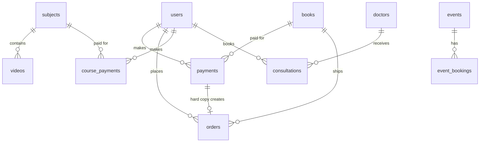
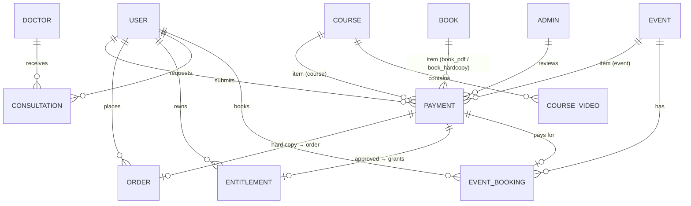

# 09 · Database Models, Schema and Relationships

**No database dump or schema file is available.** Part A rebuilds the current MySQL schema from the SQL in the PHP code and from what the live pages display. Part B is the **proposed MongoDB (Mongoose + TypeScript) design** for the rebuild. Part C lists the seed data visible on the live site.

Confidence marks: ✅ Live · 📄 Code · 🔎 Inferred · ❓ Unknown.

> **Before finalising the models:** export the live database (phpMyAdmin → Export → SQL) and check every ❓ / 🔎 column below.

---

## Part A · Current MySQL schema (reconstructed)

The site uses `mysqli` with hand-built SQL. Four tables appear in the code; the others are implied by the pages.

### A.1 `users` (📄 `forget.php`, session keys)

| Column | Type (guess) | Evidence |
| --- | --- | --- |
| `id` | INT PK AI | `$_SESSION['user_id']` / `$_SESSION['id']` |
| `name` | VARCHAR | Register form, `$_SESSION['name']` |
| `email` | VARCHAR UNIQUE | `SELECT * FROM users WHERE email=…` |
| `password` | VARCHAR | Register/login forms; **hash algorithm ❓** |
| `reset_token` | VARCHAR(64) | `UPDATE users SET reset_token=…` |
| `reset_expires` | DATETIME | now + 1 hour |
| `created_at` | DATETIME | 🔎 |

### A.2 `books` (📄 `books_details.php`, ✅ `books.php`)

| Column | Evidence |
| --- | --- |
| `id` | `?books=26` |
| `book_title` | 📄 `$row['book_title']` |
| `book_author` | 📄 `$row['book_author']` ("Sadhaka Jamwant") |
| `price` | 📄 PDF price; hard copy = price + 200 |
| description | 📄 "Book Description" (formatted with `nl2br`) — column name ❓ |
| cover image | ✅ `Books/book_<uniqid>.png/jpg` — column name ❓ |
| pdf file | 🔎 `Books_pdf/bookpdf_<uniqid>.pdf` (same uniqid timestamp pattern as the cover) — column name ❓ |
| pages, published year, rating | 📄 shown ("155 Pages", "Published: 2025", "4.5 (1,234 reviews)") — **may be hard-coded ❓** |

### A.3 `payments` (📄 `books_details.php`)

| Column | Values / notes |
| --- | --- |
| `id` | PK |
| `user_id` | FK → users.id |
| `book_id` | FK → books.id |
| `transaction_id` | UPI reference typed by the user |
| `screenshot` | file name in `uploads/` (e.g. `1764143517_241300008042.jpg`) |
| `payment_status` | `pending` → `approved` (others ❓) |
| `purchase_type` | `pdf` \| `hardbook` |
| `amount` | number (₹) |
| `order_id` | **mixed use**: the `orders.id` for hard copies, or the **order number string** for PDFs (design flaw) |
| `created_at` | used for "latest payment" ordering |

### A.4 `orders` (📄 `books_details.php`)

| Column | Values / notes |
| --- | --- |
| `id` | PK |
| `order_number` | `ORD` + `YYYYMMDDHHMMSS` + 3 random digits |
| `user_id`, `book_id`, `payment_id` | FKs |
| `amount` | ₹ |
| `order_status` | `pending` (others ❓) |
| `shipping_address` | **JSON text**: `{full_name, phone, address, city, state, pincode, landmark}` |
| `created_at` | 🔎 |

### A.5 Implied tables (names ❓)

| Entity | Fields seen on the pages | Evidence |
| --- | --- | --- |
| **Courses** ("subjects") | `id`, `subject_name`, description, image (`Courses/<time>_<name>`), `price`, discount (40%), `total_videos` | ✅ `courses.php`, 📄 `$subject[...]` |
| **Course videos** | `subject_id`, title, YouTube embed link, free flag, sort order | ✅ `get_videos.php` output (`data-video-link`, `data-free`) |
| **Course payments / enrolments** | user, subject, transaction ID, screenshot, status, amount | 🔎 `payment.php`, `payment_success.php` (Payment ID), `my_courses.php` |
| **Doctors** | `id`, `name`, specialisations text, qualification (BNYS/BHMS/Traditional Vaidya), experience years, fee, category (Physical / Mental / Chronic), bio, photo (`uploads/doctors/doctor_<uniqid>.jpg`), CV file, rating 4.7, "Verified", "Available Today" | ✅ `health.php`, 📄 `doctor_detail.php` |
| **Consultations** | doctor_id, user_id, patient_name, patient_email, patient_phone, patient_age, medical_issue, appointment_date, preferred_time, symptoms, additional_notes, status | 📄 form fields |
| **Events / programmes** | title, category (retreat/seminar/online), date, time, location, price, image (`assets/img/events/<time>_<name>.jpg`), description | 📄 `programes.php`, 🔎 uploads |
| **Event bookings** | event, transaction ID, name, email, phone, status | 📄 booking form |
| **Admins** | `username`, `password` (separate from users: admin login uses a **username**) | ✅ admin login form |

### A.6 Current relationships



---

## Part B · Proposed MongoDB schema (Mongoose + TypeScript)

### B.1 Design decisions

| Decision | Reason |
| --- | --- |
| Keep a numeric **`legacyId`** on every migrated document | Old URLs (`books_details.php?books=26`, `course_details.php?subject_id=7`, `doctor_id=11`) must keep working via redirects; easier data reconciliation |
| Add a **`slug`** to books, courses, doctors, events | Clean new URLs (`/books/patience-in-life`) |
| One **`Payment`** collection for all products (`itemType`) | Same UPI + screenshot + admin approval flow everywhere; one admin queue |
| `Order` only for physical delivery (hard copies) | Shipping lifecycle is separate from payment approval |
| Store the address as an **embedded sub-document**, not a JSON string | Queryable and validated |
| Store **money as integers in paise** (or Decimal128) | Avoid floating-point errors; display as ₹ |
| Files stored by key/path, never served directly for paid content | PDFs and payment screenshots become private |
| `timestamps: true` on all schemas | `createdAt` / `updatedAt` |
| Separate `Admin` collection (username login) | Matches the current admin login; or use `User.role` (decision: see [12](12-migration-plan.md#13-open-questions-and-blockers)) |

### B.2 Entity relationship diagram



### B.3 Shared types

```ts
// backend/src/shared/types/common.ts
export type ObjectId = string;
export type Money = number;                    // integer paise (₹1 = 100)
export type PaymentStatus = 'pending' | 'approved' | 'rejected';
export type OrderStatus = 'pending' | 'processing' | 'shipped' | 'delivered' | 'cancelled';
export type ItemType = 'book_pdf' | 'book_hardcopy' | 'course' | 'event' | 'consultation';
export type DoctorCategory = 'physical' | 'mental' | 'chronical'; // same keys as the live tabs (data-category)
export type EventCategory = 'retreat' | 'seminar' | 'online';
export type ConsultationStatus = 'pending' | 'confirmed' | 'completed' | 'cancelled';
export type PreferredTime = 'morning' | 'afternoon' | 'evening' | 'any';

export interface Address {
  fullName: string;   // required
  phone: string;      // /^[0-9]{10}$/
  address: string;    // required
  city: string;
  state: string;      // Indian state list (select)
  pincode: string;    // /^[0-9]{6}$/
  landmark?: string;
}

export interface StoredFile {
  key: string;        // storage key/path
  originalName: string;
  mimeType: string;
  size: number;       // bytes
}
```

### B.4 Collections

#### `users`

| Field | Type | Rules |
| --- | --- | --- |
| `_id` | ObjectId | |
| `legacyId` | number | unique, sparse |
| `name` | string | required, trimmed, 2–100 chars |
| `email` | string | required, **unique**, lowercase |
| `passwordHash` | string | bcrypt; `select: false` |
| `passwordResetTokenHash` | string | sha256 of the token; `select: false` |
| `passwordResetExpires` | Date | now + 1 h |
| `legacyPasswordHash`, `legacyAlgo` | string | only for migrated non-bcrypt hashes; removed after the first login ([05 § B.5](05-authentication.md#b5-migrating-existing-passwords)) |
| `isActive` | boolean | default `true` |
| `lastLoginAt` | Date | |
| `createdAt` / `updatedAt` | Date | |

Indexes: `{ email: 1 }` unique, `{ legacyId: 1 }` unique sparse.

#### `admins`

| Field | Type | Rules |
| --- | --- | --- |
| `username` | string | required, unique |
| `passwordHash` | string | bcrypt |
| `name`, `email` | string | optional |
| `role` | `'superadmin' \| 'admin'` | default `admin` |
| `lastLoginAt` | Date | |

#### `books`

| Field | Type | Rules |
| --- | --- | --- |
| `legacyId` | number | unique sparse (26, 27, 28, 30, …) |
| `slug` | string | unique |
| `title` | string | required (Hindi allowed) |
| `author` | string | default "Sadhaka Jamwant" |
| `description` | string | multi-line text (shown with line breaks) |
| `pricePdf` | Money | required |
| `priceHardcopy` | Money | default `pricePdf + 20000` (₹200); store explicitly |
| `pages` | number | optional |
| `publishedYear` | number | optional |
| `rating`, `reviewCount` | number | optional (currently display-only) |
| `cover` | StoredFile | public image |
| `pdf` | StoredFile | **private** |
| `hardcopyAvailable` | boolean | default `true` |
| `isPublished` | boolean | default `true` |
| `sortOrder` | number | |

#### `courses` (current "subjects")

| Field | Type | Rules |
| --- | --- | --- |
| `legacyId` | number | 5, 6, 7, 8 … |
| `slug` | string | unique |
| `title` | string | required |
| `description` | string | long text; cards show the first ~20 characters + "..." |
| `image` | StoredFile | public |
| `price` | Money | |
| `discountPercent` | number | default 40; original price = `floor(price / (1 - discount/100))` |
| `level` | string | default "All Levels" |
| `hasCertificate` | boolean | default `true` |
| `accessType` | `'lifetime'` | display "Lifetime Access" |
| `isNewArrival` / `isPopular` | boolean | drive the home page "🎨 New Arrivals" / "🔥 Most Popular" lists (🔎 selection rule ❓) |
| `isPublished`, `sortOrder` | | |
| `videoCount` | number | denormalised count of published videos |

#### `courseVideos`

| Field | Type | Rules |
| --- | --- | --- |
| `course` | ObjectId → courses | required, indexed |
| `title` | string | required |
| `youtubeId` | string | store the ID (e.g. `Aye-26h2v4s`); build the embed URL on the client |
| `isFree` | boolean | default `false` |
| `sortOrder` | number | shown as "1.", "2.", … |
| `durationSec` | number | optional |
| `isPublished` | boolean | |

Index: `{ course: 1, sortOrder: 1 }`.

#### `payments`

| Field | Type | Rules |
| --- | --- | --- |
| `user` | ObjectId → users | required (from the session, never the form) |
| `itemType` | ItemType | required |
| `item` | ObjectId | ref by `itemType` (Book / Course / Event) |
| `amount` | Money | **calculated on the server** from the item |
| `upiTransactionId` | string | required, trimmed; unique per `itemType` (prevents duplicate claims) |
| `screenshot` | StoredFile | **private**; jpg/png/webp/gif, ≤ 5 MB |
| `status` | PaymentStatus | default `pending` |
| `reviewedBy` | ObjectId → admins | |
| `reviewedAt` | Date | |
| `rejectionReason` | string | |
| `orderNumber` | string | `ORD` + `YYYYMMDDHHMMSS` + 3 digits; unique |
| `order` | ObjectId → orders | hard copy only |
| `shippingAddress` | Address | hard copy only (copied to the order) |
| `legacyId` | number | |

Indexes: `{ user: 1, itemType: 1, item: 1, createdAt: -1 }`, `{ status: 1, createdAt: -1 }`, `{ orderNumber: 1 }` unique.

#### `orders` (physical delivery)

| Field | Type | Rules |
| --- | --- | --- |
| `orderNumber` | string | unique (same as the payment) |
| `user`, `book`, `payment` | ObjectIds | required |
| `amount` | Money | |
| `shippingAddress` | Address | required |
| `status` | OrderStatus | default `pending` |
| `trackingNumber`, `courier` | string | optional (new) |
| `statusHistory` | `{ status, at, by }[]` | audit trail |

#### `entitlements` (what a user can access)

| Field | Type | Rules |
| --- | --- | --- |
| `user` | ObjectId | required |
| `itemType` | `'book_pdf' \| 'course'` | |
| `item` | ObjectId | Book or Course |
| `payment` | ObjectId | the approved payment that granted it |
| `grantedAt` | Date | |
| `expiresAt` | Date \| null | null = lifetime (the home page says "1 Year Access" while course pages say "Lifetime Access": **decision needed**) |

Unique index `{ user: 1, itemType: 1, item: 1 }`. Created when an admin approves a payment. An approved **hard-copy** purchase also grants `book_pdf` access (the current code treats either as purchased: 🔎 confirm).

#### `doctors`

| Field | Type | Rules |
| --- | --- | --- |
| `legacyIds` | number[] | e.g. `[9, 10]` after merging duplicates; used for redirects |
| `slug` | string | |
| `name` | string | **without** "Dr." (the UI adds the prefix: fixes "Dr. Dr.") |
| `categories` | DoctorCategory[] | one doctor can be in several categories (fixes the duplicate records) |
| `specialisations` | string | long text (Hindi/English) |
| `qualification` | string | BNYS, BHMS, Traditional Vaidya … |
| `experienceYears` | number | |
| `fee` | Money | ₹299 / ₹499 |
| `bio` | string | |
| `photo` | StoredFile | public |
| `cv` | StoredFile | downloadable |
| `rating` | number | 4.7 (display) |
| `isVerified` | boolean | "Verified" badge |
| `availabilityText` | string | "Available Today" |
| `isActive`, `sortOrder` | | |

#### `consultations`

| Field | Type | Rules |
| --- | --- | --- |
| `doctor` | ObjectId | required |
| `user` | ObjectId | required (session) |
| `patientName`, `patientEmail`, `patientPhone` | string | phone 10 digits |
| `patientAge` | number | 1–120 |
| `medicalIssue` | string | required |
| `appointmentDate` | Date | today or later |
| `preferredTime` | PreferredTime | |
| `symptoms` | string | required |
| `additionalNotes` | string | optional |
| `consentAccepted` | boolean | must be `true` |
| `status` | ConsultationStatus | default `pending` |
| `adminNotes` | string | |

#### `events`

| Field | Type | Rules |
| --- | --- | --- |
| `legacyId`, `slug` | | |
| `title` | string | |
| `category` | EventCategory | tab: Retreat Programs / Seminars & Workshops / Online Classes |
| `description` | string | |
| `startDate`, `endDate` | Date | optional for "Online - Anytime" |
| `dateText`, `timeText` | string | display text as on the current UI ("October 15, 2026", "9:00 AM - 5:00 PM", "Flexible") |
| `location` | string | |
| `price` | Money | |
| `image` | StoredFile | |
| `capacity` | number | optional |
| `ctaLabel` | `'Book Now' \| 'Enroll Now'` | |
| `isPublished`, `sortOrder` | | |

#### `eventBookings`

| Field | Type | Rules |
| --- | --- | --- |
| `event` | ObjectId | |
| `user` | ObjectId | |
| `name`, `email`, `phone` | string | phone 10 digits |
| `payment` | ObjectId → payments | itemType `event` |
| `status` | `'pending' \| 'confirmed' \| 'cancelled'` | |

#### Other collections (new features, settings, sessions, audit)

| Collection | Fields |
| --- | --- |
| `contactMessages` | name, email, phone, project, subject, message, status (`new`/`read`/`replied`) |
| `guidanceRequests` | name, email, preferredMentor (`swami` \| `priya` \| `rajan` \| `any`, the live option values), goals (text, optional), plan (optional, if wired to the session plans), status |
| `newsletterSubscribers` | email (unique), subscribedAt, isActive |
| `auditLogs` | actor (admin id), action, entity, entityId, before/after (diff), ip, at |
| `settings` | single document `{ key: "site" }`: phone, email, address, workingHours[], socialLinks{}, upi { defaultId, hardcopyId, qrImage }, hardcopySurcharge, courseDiscountDefault |
| `sessions` | managed by `connect-mongo` (TTL index on `expires`); user and admin sessions |

### B.5 Example Mongoose model (pattern for all models)

```ts
// backend/src/models/Book.ts
import { Schema, model, InferSchemaType } from 'mongoose';
import { storedFileSchema } from './shared';

const bookSchema = new Schema(
  {
    legacyId: { type: Number, unique: true, sparse: true },
    slug: { type: String, required: true, unique: true },
    title: { type: String, required: true, trim: true },
    author: { type: String, default: 'Sadhaka Jamwant' },
    description: { type: String, default: '' },
    pricePdf: { type: Number, required: true, min: 0 },        // paise
    priceHardcopy: { type: Number, required: true, min: 0 },   // paise
    pages: Number,
    publishedYear: Number,
    rating: Number,
    reviewCount: Number,
    cover: { type: storedFileSchema, required: true },
    pdf: { type: storedFileSchema, required: true, select: false }, // private
    hardcopyAvailable: { type: Boolean, default: true },
    isPublished: { type: Boolean, default: true },
    sortOrder: { type: Number, default: 0 },
  },
  { timestamps: true },
);

export type BookDoc = InferSchemaType<typeof bookSchema>;
export const Book = model('Book', bookSchema);
```

### B.6 MySQL → MongoDB field mapping

| MySQL | MongoDB |
| --- | --- |
| `users.id` | `users.legacyId` |
| `users.password` | `users.passwordHash` (see the password note in [12](12-migration-plan.md#7-data-and-file-migration)) |
| `users.reset_token` / `reset_expires` | dropped (users request a new link) |
| `books.id / book_title / book_author / price` | `legacyId / title / author / pricePdf (×100)`; `priceHardcopy = (price + 200) × 100` |
| `payments.*` (book) | `payments` with `itemType = purchase_type === 'pdf' ? 'book_pdf' : 'book_hardcopy'`, `upiTransactionId = transaction_id`, `status = payment_status` |
| `payments.order_id` (mixed) | PDF: `orderNumber`; hard copy: look up `orders` → `order` ref + `orderNumber` |
| `orders.shipping_address` (JSON) | `orders.shippingAddress` (parsed sub-document) |
| approved payments | also create `entitlements` |
| subjects / videos / course payments / doctors / consultations / events / bookings | the matching collections (column names ❓ until the dump is available) |

---

## Part C · Seed data visible on the live site (12 Oct 2026)

### Books (`books.php`)

| legacyId | Title | Cover | Price |
| --- | --- | --- | --- |
| 26 | Patience in Life | `Books/book_6944e13695250.png` | PDF ₹100 · Hard ₹300 (📄 local copy) |
| 27 | धैर्य | `Books/book_69494cf552223.jpg` | ❓ |
| 28 | विज्ञान तथा अध्यात्म | `Books/book_69494dc648644.png` | ❓ |
| 30 | Science & Spiritual | `Books/book_69494f59259d5.png` | ❓ |

`Books/` holds 26 cover files and `Books_pdf/` 25 PDFs, so the database probably contains more (unpublished or deleted) books ❓.

### Courses (`courses.php`, `course_details.php`)

| legacyId | Title | Price | Discount | Videos | Image |
| --- | --- | --- | --- | --- | --- |
| 8 | Audio book "धैर्य" | ₹19.00 | 40% | 0 | `Courses/1770529279_78241.png` |
| 7 | Emotional Command | ₹499.00 (orig. ₹831) | 40% | 16 | `Courses/1769870100_109497.png` |
| 6 | सम्पूर्ण स्वास्थ्य विज्ञान | ₹499.00 | 40% | 29 | `Courses/1769156661_103748.png` |
| 5 | सांख्यकारिका | ₹199.00 | 40% | 51 | `Courses/1769662428_108079.png` (home) |

Home page lists: **New Arrivals** = 8, 7, 6 · **Most Popular** = 6, 5, 7.

Course 7 video titles (all **paid**, YouTube embeds): 1 धैर्य · 2 काम एवं क्रोध पर नियंत्रण · 3 मोह से निवृत्ति · 4 ईर्ष्या भाव का आधार · 5 भय · 6 नशा से मुक्ति · 7 अहंकार · 8 लोभ और आवश्यकता में अंतर · 9 साधना का पथिक क्रम · 10 शरीर की स्वस्थता · 11 प्राण ऊर्जा का संतुलन · 12 मन की स्थिरता · 13 मन का अंतर्मुखी होना · 14 अहंकार की शून्यता · 15 बुद्धि की व्यापकता · 16 चित्त की शुद्धि (each prefixed "Emotional Command कोर्स/भाग N").

### Doctors (`health.php`)

| legacyId | Name (as stored) | Category | Qualification | Experience | Fee | Photo |
| --- | --- | --- | --- | --- | --- | --- |
| 11 | Dr. Manoranjan shau | Physical | BNYS | 10 yrs | ₹499 | `uploads/doctors/doctor_68f09d40c317a.jpg` |
| 12 | Vaidya Sudarshan | Physical | Traditional Vaidya | 7 yrs | ₹299 | `uploads/doctors/doctor_697b878b15788.jpg` |
| 10 | Suharidia sharma | Mental | BHMS | 5 yrs | ₹499 | `uploads/doctors/doctor_6978ee8eb4cc2.jpg` |
| 9 | suharidia sharma | Chronic | BHMS | 5 yrs | ₹499 | `uploads/doctors/doctor_6978ed3abc992.jpg` |
| 13 | vaidya sudarshan | Chronic | Traditional ayurveda | 7 yrs | ₹299 | `uploads/doctors/doctor_6978f1b30057b.jpg` |

IDs 9/10 and 12/13 are the **same people** listed under two categories. During migration merge them into one doctor each with `categories: [...]`, and redirect the old IDs.

### Events

See [04-workflows.md](04-workflows.md), section 7 (local sample data; live list ❓).
