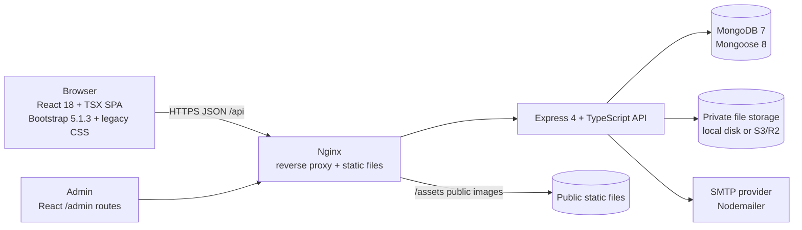

# 12 · PHP → MERN Migration Plan

What is needed to rebuild sanyod.in on MongoDB, Express, React (TSX) and Node.js inside `replica-website/` while **keeping the overall UI and every existing function**, plus the fixes listed in [02 § 4](02-features.md#4-existing-defects-the-rebuild-must-fix).

**Ground rule:** the PHP codebase (`D:\sanyod.in\*.php` and its folders) and the live website are **read-only references**. All new code, assets and docs live in `replica-website/`.

Confidence marks: ✅ Live · 📄 Code · 🔎 Inferred · ❓ Unknown.

---

## 1. Goals and principles

| # | Principle |
| --- | --- |
| 1 | **New look, same behaviour:** the public site uses the SANYOD design system; routes, workflows and rules stay as on live ([D-27](14-open-questions-and-decisions.md#3-decisions-log), replaces the earlier "same look" rule). |
| 2 | **Same functionality:** every flow in [04](04-workflows.md) works the same for users, including the manual UPI payment + admin approval. |
| 3 | **Fix what's broken or insecure** (500/404 pages, exposed PDFs/videos/admin, fake forms), invisibly to the user. |
| 4 | **Old links keep working:** every legacy `.php` URL 301-redirects to its new route. |
| 5 | **TypeScript end to end:** shared types and zod schemas used by both client and server. |
| 6 | **Data preserved:** users, purchases, orders, courses, videos, doctors and files migrate with their legacy IDs. |

---

## 2. Target architecture



| Layer | Choice |
| --- | --- |
| Client | Vite + React 18 + TypeScript, React Router v6, TanStack Query, react-hook-form + zod, react-helmet-async, sweetalert2, bootstrap 5.1.3 |
| Server | Node 20 LTS, Express 4, TypeScript, Mongoose 8, zod, multer, bcrypt, express-session + connect-mongo, nodemailer, helmet, cors, express-rate-limit, pino |
| Database | MongoDB 7 (Atlas M10+ or self-hosted with backups) |
| Files | Public: covers, course images, doctor photos, event images. **Private:** book PDFs, payment screenshots, doctor CVs (served through authorised endpoints) |
| Hosting | **The current shared PHP hosting can't run a Node API** unless it offers "Setup Node.js App" (Passenger) ❓. Recommended: a small VPS (2 vCPU / 4 GB) with Docker or PM2 + Nginx + Let's Encrypt, or the client on Netlify/Vercel + the API on Render/Railway/VPS. |

SEO note: the current site is server-rendered. A plain SPA gives the same UI but weaker SEO. If search ranking matters, use **Vite SSR / prerendering** for public pages (e.g. `vite-plugin-ssr`/Vike, or prerender the static routes at build time) without changing the UI. **Decision needed** ([14](14-open-questions-and-decisions.md)).

---

## 3. Repository structure

```text
replica-website/
├─ docs/        # this documentation set (source of truth before and during development)
├─ reference/   # read-only captures of the live site (see reference/README.md)
├─ frontend/    # React 18 + TSX (Vite) app: public site + /admin
└─ backend/     # Node 20 + Express + TypeScript API, MongoDB models, scripts
```

Detailed folder layouts: [07-frontend-architecture.md](07-frontend-architecture.md) and [08-backend-architecture.md](08-backend-architecture.md). Shared types and zod schemas live in `backend/src/shared/` and are imported by the frontend through the `@shared/*` alias.

---

## 4. URL and route mapping

Implement once on the server (Nginx or Express) so search engines and old links get proper **301** redirects:

| Legacy URL | Redirect to |
| --- | --- |
| `/index.php` | `/` |
| `/programes.php` | `/programs` |
| `/Personality_Test.php` | `/personality-test` |
| `/books.php` | `/books` |
| `/books_details.php?books={legacyId}` | `/books/{slug}` (look up by `legacyId`) |
| `/my_books.php` · `/view_book.php` · `/read_pdf.php` · `/view_pdf.php` | `/my-books` |
| `/my_orders.php` | `/my-orders` |
| `/courses.php` · `/Courses.php` | `/courses` |
| `/course_details.php?subject_id={legacyId}` | `/courses/{slug}` |
| `/payment.php?subject_id={legacyId}` | `/courses/{slug}/payment` |
| `/payment_success.php` · `/payment_status.php` | `/my-courses` |
| `/my_courses.php` | `/my-courses` |
| `/health.php` | `/health` |
| `/doctor_detail.php?doctor_id={legacyId}` | `/health/doctors/{slug}` (merged doctors: 9→10's doctor, 13→12's doctor) |
| `/download_cv.php?doctor_id={id}` | `/api/doctors/{id}/cv` |
| `/ind_know.php` · `/Spirituality.php` | `/spirituality/indian-knowledge` |
| `/lab.php` | `/spirituality/library` |
| `/counity.php` | `/spirituality/community` |
| `/presonal.php` | `/spirituality/personal-guidance` |
| `/about.php` · `/contact.php` · `/Peace_Building.php` | `/about` · `/contact` · `/peace-building` |
| `/login.php` · `/register.php` · `/forget.php` · `/reset_password.php?token=&email=` | `/login` · `/register` · `/forgot-password` · `/reset-password?token=` |
| `/logout.php` | `/` (after clearing the session) |
| `/admin/login.php` · `/admin/*` | `/admin/login` · `/admin` |
| `/blog.php` · `/service.php` · `/team.php` · `/testimonial.php` · `/index.html` | `/` (unless the owner keeps them) |

Express example:

```ts
// backend/src/routes/legacyRedirects.ts
// Keys are lower-case so /Courses.php and /courses.php both match.
const STATIC: Record<string, string> = {
  '/index.php': '/', '/books.php': '/books', '/courses.php': '/courses', /* … */
};
router.get(/\.php$/i, async (req, res, next) => {
  const path = req.path.toLowerCase();
  if (STATIC[path]) return res.redirect(301, STATIC[path]);
  if (path === '/books_details.php') {
    const b = await Book.findOne({ legacyId: Number(req.query.books) }, 'slug');
    return res.redirect(301, b ? `/books/${b.slug}` : '/books');
  }
  // course_details, payment, doctor_detail … same pattern
  next();
});
```

Front-end routes and guards:

```tsx
// frontend/src/router.tsx (excerpt)
<Route element={<Layout />}>
  <Route index element={<HomePage />} />
  <Route path="books" element={<BooksPage />} />
  <Route path="books/:slug" element={<RequireAuth><BookDetailPage /></RequireAuth>} />
  <Route path="courses" element={<CoursesPage />} />
  <Route path="courses/:slug" element={<CourseDetailPage />} />
  <Route path="courses/:slug/payment" element={<RequireAuth><CoursePaymentPage /></RequireAuth>} />
  <Route path="programs" element={<RequireAuth><ProgramsPage /></RequireAuth>} />
  <Route path="health" element={<HealthPage />} />
  <Route path="health/doctors/:slug" element={<RequireAuth><DoctorDetailPage /></RequireAuth>} />
  <Route path="my-books" element={<RequireAuth><MyBooksPage /></RequireAuth>} />
  {/* … */}
</Route>
```

`RequireAuth` saves the current location and redirects to `/login`; after login the user returns there (same as the PHP `redirect_url`).

---

## 5. Keeping the UI identical

> **Superseded by [D-27](14-open-questions-and-decisions.md#3-decisions-log) (21 Nov 2026):** the public site no longer copies the live CSS and markup; it uses the new design system. This section is kept for history. The pixel-diff gate below no longer applies to the public site.

This is the most important part of the migration.

### 5.1 Markup: convert, don't redesign

1. Take the **live HTML** of each page (or the local file where it matches live; see [06 § 5](06-ui-design-and-components.md#5-page-inventory-routes)) and convert it to JSX **keeping every element, class and order**.
2. Mechanical conversion rules: `class` → `className`, `for` → `htmlFor`, inline `style="a:b"` → `style={{ a: 'b' }}`, self-close void tags, `onclick` → `onClick` handlers, `&nbsp;`/entities preserved, `<!-- comments -->` removed.
3. Replace the PHP-generated repeated blocks (books, courses, videos, doctors, events) with `.map()` over API data, producing **exactly** the same markup per item.
4. Don't carry over the errors: the duplicate header in local `index.php` (lines 864–935), Markdown fences, nested `<!DOCTYPE>`/`<head>`/`<body>` tags. Move the `<style>`/`<link>` tags from nested heads into CSS imports.
5. Text content (Hindi/English) must be copied **verbatim** (including emoji). Put long static texts in `frontend/src/data/*.ts` if it helps readability.

### 5.2 CSS: same files, same order, scoped per page

Recreated in `frontend/src/main.tsx` (implemented in Phase 1; details in [07 § 6](07-frontend-architecture.md#6-css-pipeline-key-to-an-identical-ui)):

```ts
import 'bootstrap/dist/css/bootstrap.min.css';               // 5.1.3 (CDN equivalent)
import './styles/legacy/bootstrap.theme.min.css';            // themed 5.0.0 → red/navy brand
import '@fortawesome/fontawesome-free/css/all.min.css';      // 5.15.4
import 'bootstrap-icons/font/bootstrap-icons.css';           // 1.4.1
import './styles/legacy/style.css';                          // template CSS
import './styles/layout/header.css';
import './styles/layout/footer.css';                         // global
// page CSS (*.page.css) is imported by each page component, scoped to body.page-<name>
```

| Problem | Fix |
| --- | --- |
| In an SPA every visited page's CSS stays loaded; in PHP only one page's CSS existed at a time, and it uses generic selectors (`.hero`, `body`, `:root`) | Each page's inline `<style>` is copied unchanged to `*.page.css` and scoped by `scripts/postcss-page-scope.js` to `body.page-<name>`; the page calls `useBodyClass` |
| The footer `<style>` came last on live (body font Segoe UI, background colour, CSS variables) | Footer body rule written as `:root body.sanyod`; page copies of footer-defined variables are dropped |
| Keyframes with the same name on several pages | Renamed per page by the same plugin (`pulse--page-login`) |
| `style.css` uses `url(../img/…)` | Copy points to `/img/…` (served from `public/`) |
| Fonts | `index.html` keeps the live Google Fonts `<link>` (Lato, Montserrat); Poppins and Paytone One for admin only |
| Version drift | Bootstrap **5.1.3** CSS, FA **5.15.4**, BI **1.4.1** pinned exactly (see [11 § 7](11-third-party-integrations.md#7-version-pinning-for-an-identical-ui)) |

### 5.3 JavaScript behaviour

Port each inline script to hooks (see [06 § 7](06-ui-design-and-components.md#7-front-end-behaviour-to-port-jquery--vanilla--react)). Keep the same timings (e.g. 0.6 s reveal, 800 ms scroll, typing speeds), the same DOM classes toggled, and the same SweetAlert texts and buttons.

### 5.4 Visual verification (required)

- **Playwright** script: for each public route, take screenshots of `http://sanyod.in/<legacy>.php` and of the new `/<route>` at 1440/1024/768/390 px, then compare with `pixelmatch` (mask dynamic areas such as the YouTube iframe, particles and typing text). This is the acceptance gate for "same UI".
- Run it in CI for every pull request.

---

## 6. PHP file → MERN mapping

| PHP file | React page/component | API endpoints (see [10](10-api-specification.md)) | Notes |
| --- | --- | --- | --- |
| `header.php` | `TopBar`, `NavBar` | `GET /api/auth/me` | Auth area from the `useAuth()` context |
| `footer.php` | `Footer`, `CopyrightBar`, `BackToTop` | `POST /api/newsletter` | Newsletter becomes real |
| `index.php` | `HomePage` | `GET /api/courses?home=1` | New Arrivals / Most Popular |
| `login.php` / `register.php` / `logout.php` | `LoginPage` / `RegisterPage` | `POST /api/auth/login`, `/register`, `/logout` | |
| `forget.php` / `reset_password.php` | `ForgotPasswordPage` / `ResetPasswordPage` | `POST /api/auth/forgot-password`, `/reset-password` | Email the link |
| `books.php` | `BooksPage` | `GET /api/books` | |
| `books_details.php` | `BookDetailPage` | `GET /api/books/:slug`, `GET /api/books/:id/purchase-status`, `POST /api/payments` (multipart) | Server calculates the amount |
| `my_books.php` | `MyBooksPage` | `GET /api/library/books` | |
| `read_pdf.php`, `view_pdf.php`, `view_book.php` | `ReadBookPage` + `PdfViewer` | `GET /api/library/books/:id/pdf` (stream, entitlement check) | |
| `my_orders.php` | `MyOrdersPage` | `GET /api/orders` | Currently 500: new page in the same style |
| `courses.php` | `CoursesPage` + `VideoPlaylistModal` | `GET /api/courses`, `GET /api/courses/:id/videos` | Locked videos sent **without** `youtubeId` |
| `get_videos.php` | — | `GET /api/courses/:id/videos` | JSON instead of HTML |
| `course_details.php` | `CourseDetailPage` | `GET /api/courses/:slug` | |
| `payment.php` | `CoursePaymentPage` | `POST /api/payments` (`itemType: 'course'`) | Get the live UI first ❓ |
| `payment_success.php` | `PaymentSuccessPage` | `GET /api/payments/:id` | |
| `my_courses.php` | `MyCoursesPage` | `GET /api/library/courses` | Currently broken: new page in the same style |
| `health.php` | `HealthPage` | `GET /api/doctors` | Group by category on the client |
| `doctor_detail.php` | `DoctorDetailPage` + `ConsultationForm` | `GET /api/doctors/:slug`, `POST /api/consultations` | |
| `download_cv.php` | — | `GET /api/doctors/:id/cv` | |
| `submit_consultation.php` | — | `POST /api/consultations` | |
| `programes.php` | `ProgramsPage` + `BookingModal` | `GET /api/events`, `POST /api/event-bookings` (multipart) | |
| `Personality_Test.php` | `PersonalityTestPage` | — | Fully client-side |
| `ind_know.php`, `lab.php`, `counity.php`, `presonal.php`, `about.php`, `Peace_Building.php` | Static pages | `POST /api/guidance-requests` (presonal modal) | |
| `contact.php` | `ContactPage` | `POST /api/contact` | |
| `admin/*` | `pages/admin/*` | `/api/admin/*` | Rebuild from the inferred list; confirm with the real admin source |

---

## 7. Data and file migration

### 7.1 Prerequisites

1. **phpMyAdmin export** (SQL, structure + data) of the live database.
2. **Full download** of `/home4/hawkswav/sanyod.in/` (code + all upload folders).
3. Freeze window: announce a short maintenance period, or run the migration twice (rehearsal + final delta).

### 7.2 Migration script (`backend/src/scripts/migrate-mysql.ts`)

1. Load the SQL dump into a local MySQL (Docker `mysql:8`).
2. Read each table with `mysql2` and write to MongoDB with the mapping in [09 § B.6](09-database-models.md#b6-mysql--mongodb-field-mapping):
   - keep `legacyId`; generate `slug` (transliterate Hindi titles, or use `legacyId` as a fallback slug);
   - money: rupees → paise (`Math.round(x * 100)`);
   - `orders.shipping_address` JSON → `shippingAddress` object (keep the raw value in `legacyRaw` if parsing fails);
   - `payments.order_id` (mixed): resolve to `order` (hard copy) or `orderNumber` (PDF);
   - every **approved** payment → create an `entitlement`;
   - merge duplicate doctors (9 + 10 → one; 12 + 13 → one) with `categories` arrays and keep both legacy IDs in `legacyIds`.
3. Verify the counts per table vs per collection, and spot-check 10 random users' purchases.

### 7.3 Passwords

| Legacy format (check in the dump) | Strategy |
| --- | --- |
| PHP `password_hash` (bcrypt, `$2y$…`) | Copy as-is. Compare with `bcrypt.compare(pw, hash.replace(/^\$2y\$/, '$2b$'))`. |
| MD5 / SHA1 / plain text | Store as `legacyHash` + `legacyAlgo`. On the first successful login, verify with the legacy algorithm, then save a bcrypt hash and delete `legacyHash`. Optionally force a password reset by email. |

Admins: re-create admin accounts with `backend/src/scripts/create-admin.ts` (new strong passwords).

### 7.4 Files

| From | To | Access |
| --- | --- | --- |
| `Books/book_*` | `public/Books/` (or bucket `public/books/covers/`) | Public |
| `Books_pdf/*.pdf` | **private** `storage/books/pdf/` | Entitled users only (streamed) |
| `Courses/*` | `public/Courses/` | Public |
| `uploads/doctors/*` | `public/uploads/doctors/` | Public |
| doctor CVs (❓ location) | private `storage/doctors/cv/` | Logged-in users (or public: decision) |
| `uploads/payments/*`, `uploads/*` payment screenshots | **private** `storage/payments/` | Admin only |
| `assets/img/events/*` | `public/assets/img/events/` | Public |
| `images/`, `img/` | `frontend/public/images`, `frontend/public/img` | Public (drop unused template images) |

Rename files containing spaces and update the database references during the copy (keep a CSV map).

### 7.5 Cut-over

1. Deploy the new stack on a staging domain (e.g. `new.sanyod.in`) and run the visual and functional tests.
2. Final data + file migration.
3. Switch the DNS / virtual host for `sanyod.in` to the new server; enable HTTPS.
4. Keep the PHP site read-only for 30 days as a fallback (on a private URL), then retire it.

---

## 8. Authentication and session design

Moved to **[05-authentication.md](05-authentication.md)** (user and admin login, server-side sessions, password reset, guards, rate limits). Roles and permissions: **[03-user-roles-and-permissions.md](03-user-roles-and-permissions.md)**.

---

## 9. Security fixes built into the rebuild

| # | Current problem (see [../../documentation/LIVE_VS_LOCAL_COMPARISON.md](../../documentation/LIVE_VS_LOCAL_COMPARISON.md)) | Rebuild requirement |
| --- | --- | --- |
| 1 | Admin dashboard HTML sent with the redirect | Server-side guard on every `/api/admin/*`; admin pages render nothing without a session |
| 2 | Book PDFs publicly downloadable | Private storage + entitlement check + streaming endpoint; optional watermark with the user's email |
| 3 | Paid YouTube links exposed by `get_videos.php` | API omits `youtubeId` for locked videos; consider private video hosting |
| 4 | Reset link shown on screen; token stored in plain text | Email only; store the token hash; same response for unknown emails |
| 5 | SQL injection (`$_GET['books']`) | Mongoose queries with validated params (zod), `express-mongo-sanitize` |
| 6 | `user_id` / `amount` trusted from the form | User from the session; amount calculated on the server |
| 7 | Uploads saved publicly under the original name, 0777 | Random names, magic-byte type check, size limit (5 MB), private storage |
| 8 | PHP errors shown to visitors | Central error handler, generic messages, logs only on the server |
| 9 | No CSRF protection | SameSite + CSRF token |
| 10 | Duplicate UPI transaction IDs possible | Unique index on `upiTransactionId` (+ admin warning) |
| 11 | ✅ HTTPS works (valid certificate) but `http://` is **not redirected** to HTTPS and `www.sanyod.in` is **not redirected** to the bare domain (both serve the site) | Force HTTPS + HSTS, one canonical host (301), `helmet` security headers |
| 12 | ✅ Missing `robots.txt`, `sitemap.xml`, `favicon.ico` (all 404) | Add them (no visual change) |
| 13 | ✅ `get_videos.php` without a course ID prints a PHP warning with the server path | Validate parameters; never leak paths |

---

## 10. Environment configuration

Environment variables are specified per project: backend in [08-backend-architecture.md § 9](08-backend-architecture.md#9-configuration-and-environment-variables), frontend in [07-frontend-architecture.md § 9](07-frontend-architecture.md#9-configuration-and-environment-variables). UPI IDs, QR image, contact details and working hours go into an admin-editable **settings** document, not hard-coded JSX.

---

## 11. Deployment

| Item | Recommendation |
| --- | --- |
| Server | Ubuntu 22.04 VPS; Docker Compose (`api`, `mongo` or Atlas, `nginx`) or PM2 |
| Nginx | Serve `frontend/dist` (SPA fallback to `index.html`), `/api` → Node, `/Books/`, `/Courses/`, `/uploads/doctors/`, `/assets/img/events/` as static, **deny** private storage paths, legacy `.php` → Express redirect handler |
| HTTPS | Let's Encrypt (certbot), HSTS |
| Backups | Daily `mongodump` + storage sync to offsite (S3/R2), 30-day retention |
| Monitoring | Uptime monitor, pino logs → file/Logtail, error alerts by email |
| CI/CD | GitHub Actions: lint, type-check, unit tests, Playwright visual tests, build, deploy |

---

## 12. Phased delivery plan

| Phase | Scope | Exit criteria |
| --- | --- | --- |
| **0. Discovery** (blocking) | Get the server source + DB dump; resolve all ❓ in these docs; owner decisions ([14](14-open-questions-and-decisions.md)) | Signed-off feature list and schema |
| **1. Foundation** | `frontend` + `backend` projects, TS configs, lint/prettier, shared types/zod, Express skeleton, Mongo connection, auth, CI, Playwright baseline screenshots of live | Login/register work end to end |
| **2. Layout + static pages** | Layout shell, CSS pipeline (scoping), Home (static parts), About, Indian Knowledge, Library, Community, Personal Guidance, Peace, Contact, Personality Test | Visual diff passes for all static pages |
| **3. Books** | Books list/detail, purchase (PDF/hard copy), UPI panel, uploads, emails, My Books, PDF reader, My Orders | A purchase can be approved by an admin and the PDF read |
| **4. Courses** | Course list/detail, playlist modal, locked/free logic, course payment, success page, My Courses | Entitlement unlocks videos |
| **5. Health + Programmes** | Doctors, profile, consultation form, CV download; events, booking modal | Forms saved and visible to the admin |
| **6. Admin panel** | Dashboard, payments approval, orders, books, courses/videos, doctors, consultations, events/bookings, users, messages, settings | The admin can run the business without phpMyAdmin |
| **7. Migration + launch** | Data/file migration scripts, rehearsal, redirects, SEO meta, performance, security review, go-live | Parity checklist (§ 14) all green |

---

## 13. Open questions and blockers

Maintained in **[14-open-questions-and-decisions.md](14-open-questions-and-decisions.md)** (questions, owners, status and decisions log).

---

## 14. Parity checklist (definition of done)

- [ ] Every legacy URL redirects correctly (automated test over the list in § 4).
- [ ] Visual diff within the threshold for all public pages at 4 widths.
- [ ] Register, login, logout, forgot/reset password work; the session is shown in the navbar.
- [ ] Book PDF purchase → admin approval → appears in My Books → read/download (only for the owner).
- [ ] Hard-copy purchase with address → order created → admin updates status → user sees it in My Orders.
- [ ] Course playlist: logged-out prompt, free videos play, locked videos show the purchase dialog; purchase → approval → all videos play.
- [ ] Consultation request saved and visible in the admin; validation rules identical.
- [ ] Event booking saved with payment proof; admin confirms.
- [ ] Contact, guidance request and newsletter saved; admin notified.
- [ ] Personality Test identical in both languages and all 3 modes.
- [ ] Confirmation emails delivered from the real SANYOD domain.
- [ ] No public access to PDFs, payment screenshots or admin APIs (security test).
- [ ] Data migration counts match; 10 sampled users verified.
